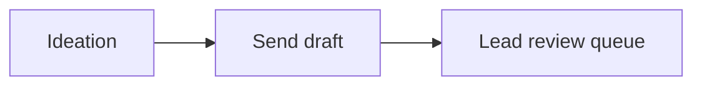
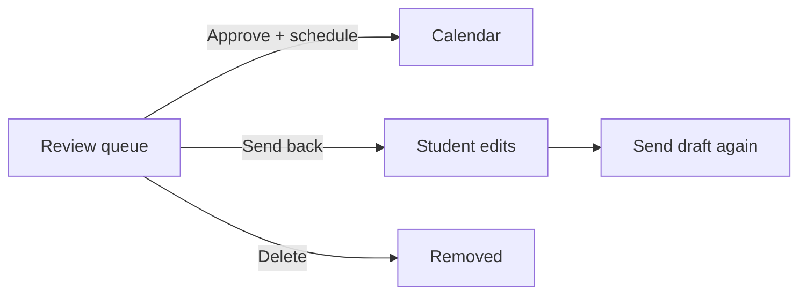

# Pulse — team workflows (CPBH)

Use this for demos and onboarding. **Hosted app:** Render web URL (not GitHub Pages).

## Workflow A — Students & contributors

### 1. Ideation (`/ideate`)

- **Hot topics** — latest brain-health trends from public feeds.
- **Caption drafts** — generate Instagram / Facebook / LinkedIn text from a topic or pasted notes (copy into Send draft).
- **Idea chat** — brainstorm angles, hooks, and patient-friendly wording (no account required beyond team login if auth is on).

### 2. Send draft (`/submit`)

- **Post vs story**
- **Content link** — one URL: **Canva design** or **Google Drive folder** with exports (no image upload required).
- **Source material** — links (Substack, handouts, articles, etc.)
- **CTA / READ link**, **link in bio**, slide numbers for dept Canva folder
- Submit receives a **ticket ID** (e.g. `CPBH-251024-A3F9`) shown on confirmation and in emails.

---

## Workflow B — Lead review & schedule (Tiffany + Hussein)

### Review (`/review`)

Each open draft is an **unfinished ticket** until one of:

| Action | Result |
|--------|--------|
| **Approve & schedule** | Pick **platforms** + **date/time** → post appears on **Schedule** |
| **Send back for edits** | Notes to student; reminders **pause** until they resubmit |
| **Delete** | Removed; reminders stop |

- **Ticket ID** on every card and email so Tiffany can reference the draft in Slack/email.
- **Emails:** immediate notice when someone submits (“Brooke submitted … — ticket CPBH-…”). **Every 12 hours** while still in the review queue until approve, send-back, or delete.

### Schedule (`/calendar`)

- Approved items scheduled from Review show here.
- Hussein (or Tiffany) can adjust timing; publishing stays schedule-only (no student publish).

---

## Hosting checklist (before presentations)

1. Render: **pulse-cpbh-db**, **pulse-cpbh-api**, **pulse-cpbh-web** all **Live**.
2. **pulse-cpbh-web** env: `API_URL=https://pulse-cpbh-api.onrender.com`
3. **pulse-cpbh-api** env: `WEB_URL=https://pulse-cpbh-web.onrender.com`, `REVIEW_LEAD_EMAIL=` (Tiffany), `RESEND_API_KEY=` (or SMTP)
4. Smoke test: Ideate → Submit → email → Review → Approve & schedule → Calendar
5. Share links: `/ideate`, `/submit`, `/review`, `/calendar`

**Free tier:** first load after idle may take 30–60s (cold start).
